# Linfocitos T en piel de vitiligo: reanálisis de scRNA-seq (GSE298871)

## Pregunta

El vitiligo es una enfermedad autoinmune en la que linfocitos T CD8 destruyen a los melanocitos, las células que producen el pigmento de la piel.

En pacientes con vitiligo, la piel lesional (LS) es la que ya perdió el pigmento. La piel no lesional (NL) es piel pigmentada de los mismos pacientes. El objetivo de este mini-proyecto es responder si los linfocitos T de la piel no lesional ya muestran alteraciones antes de que aparezca la lesión, comparándolos con los de piel lesional y con los de personas sanas.

## Antecedentes

La pregunta no es nueva. Gellatly et al. (2021) secuenciaron células individuales de piel lesional, no lesional y sana, y describieron activación inmune subclínica en la piel no lesional, contenida en parte por linfocitos T reguladores (Treg). Brunner et al. (2025), autores del dataset usado aquí, analizaron biopsias de 15 pacientes con RNA-seq bulk, que mide el ARN de todo el tejido mezclado. Encontraron que la piel no lesional ya tiene marcadores inflamatorios de los ejes T1 (CXCL9, OASL), T2 (IL4R, CCL17, CCL22) y T17 (PI3, DEFB4A). En ese trabajo, la secuenciación de célula única se usó para corroborar los hallazgos del bulk.

Este proyecto cambia la estrategia. En lugar de analizar el tejido completo, se aislaron los linfocitos T y se compararon entre condiciones con la persona como unidad de análisis, para ver si la alteración descrita en el tejido también aparece dentro de los linfocitos T.

## Datos

Se usó el dataset público GSE298871 (Brunner et al., 2025). Contiene secuenciación de ARN de célula única (scRNA-seq) de biopsias de piel humana. En scRNA-seq se mide qué genes expresa cada célula por separado, en lugar de un promedio de todo el tejido.

| Condición | Muestras | Descripción |
|---|---|---|
| Sano | 6 | Piel de donantes sin vitiligo |
| LS | 6 | Piel lesional de pacientes con vitiligo |
| NL | 5 | Piel no lesional de los mismos pacientes. Cinco pacientes tienen muestra NL y LS, y un sexto (BIO023) solo LS |

Las muestras se procesaron con la química 5' de 10x Genomics. Esta química permite secuenciar también el receptor de cada linfocito T, aunque esos datos no se publicaron en GEO. Su principal limitación es que captura solo una fracción de las moléculas de ARN de cada célula, por lo que los genes poco expresados, como las quimiocinas, aparecen con frecuencia en cero. Los métodos de transcrito completo como Smart-seq2 detectan más genes por célula, pero procesan cientos de células en lugar de miles. Para describir poblaciones inmunes en un tejido, la plataforma 10x es una elección razonable.

GEO (Gene Expression Omnibus) es la base de datos pública de donde se obtuvieron los datos. Solo ofrece las matrices de conteo generadas por Cell Ranger 7.2, sin los archivos FASTQ con las lecturas originales.

Cell Ranger es el software de 10x Genomics que convierte las lecturas de secuenciación en una matriz de conteo. El programa consta de tres pasos principales. Primero separa las lecturas por célula, usando el código de barras que cada gota agrega a todo el ARN de su célula. Después alinea cada lectura al genoma humano de referencia (GRCh38) para saber de qué gen proviene. Por último cuenta las moléculas de cada gen en cada célula, usando un segundo código (UMI) que marca cada molécula original, para no contar dos veces las copias que se generan durante la amplificación.

Cada muestra tiene tres archivos. `matrix.mtx` contiene los conteos, `barcodes.tsv` el código de barras de cada célula, y `features.tsv` los genes, identificados por su código de Ensembl (por ejemplo ENSG00000111640) y por su símbolo (por ejemplo GAPDH). En el análisis se usó el símbolo. La matriz tiene una fila por gen y una columna por célula, y cada valor es el número de moléculas de ese gen detectadas en esa célula.

GEO no incluye sexo, edad ni actividad de la enfermedad de los donantes. El material suplementario de Brunner et al. solo describe a la cohorte de RNA-seq bulk en conjunto (15 pacientes, VIDA promedio de 0.87 en una escala de 0 a 3), sin valores por paciente, y tampoco explica qué significan los prefijos de las muestras (DER, CON, BIO). El sexo se dedujo de la expresión de genes del cromosoma Y.

## Métodos

El análisis se divide en nueve notebooks que se corren en orden. Los pasos de célula única usan Python con Scanpy, una librería para analizar datos de célula única. La expresión diferencial usa R con DESeq2, un paquete que prueba si la expresión de un gen cambia entre grupos con un modelo estadístico diseñado para conteos.

### 1. Carga y control de calidad (`01_carga`, `02_qc`)

Se cargaron las 17 matrices y se unieron en un solo objeto AnnData, la estructura de Scanpy que guarda la matriz de células por genes junto con tablas de información por célula (muestra, condición) y por gen. El objeto inicial tuvo 24,746 células. A cada célula se le calcularon tres métricas:

1. El número de moléculas detectadas
2. El número de genes detectados
3. El porcentaje de moléculas provenientes de genes mitocondriales

Un porcentaje mitocondrial alto indica una célula dañada. Cuando la membrana de la célula se rompe, el ARN del citoplasma se escapa, pero las mitocondrias tienen su propia doble membrana y retienen sus transcritos. La fracción mitocondrial de lo que queda aumenta.

Los umbrales se definieron por muestra con la desviación absoluta mediana (MAD). Se calcula por separado para cada métrica y cada muestra. Por ejemplo, para el número de genes de la muestra 465, se toma la mediana del número de genes de todas las células de 465, luego la distancia de cada célula a esa mediana, y por último la mediana de esas distancias. Para moléculas y genes se usó el logaritmo de los valores, porque sus distribuciones son muy asimétricas. Con los valores 10, 11, 12, 13 y 500, la mediana es 12 y la MAD es 1. El valor 500 no cambia la MAD, mientras que la desviación estándar sí aumentaría mucho. Por eso la MAD describe bien la dispersión típica aunque haya células extremas.

Se eliminaron las células cuya cantidad de moléculas o de genes se alejaba de la mediana de su muestra más de 5 veces la MAD, y las células con porcentaje mitocondrial a más de 3 MAD o mayor a 20%. El corte de 5 MAD es permisivo a propósito, para no eliminar células reales que son grandes o muy activas. Se usaron umbrales por muestra porque la mediana mitocondrial varió entre 1.9% y 8.9%, y un umbral fijo habría eliminado de forma desigual a unas muestras y a otras.

Después se usó Scrublet, una herramienta de Python que detecta dobletes. Un doblete es una gota de la plataforma que capturó dos células a la vez y aparenta ser un tipo celular intermedio. Scrublet simula dobletes combinando pares de células reales y marca las células reales que se parecen a esas simulaciones. Se eliminaron 64 dobletes. Al final del control de calidad quedaron 20,369 células, el 82% del total.

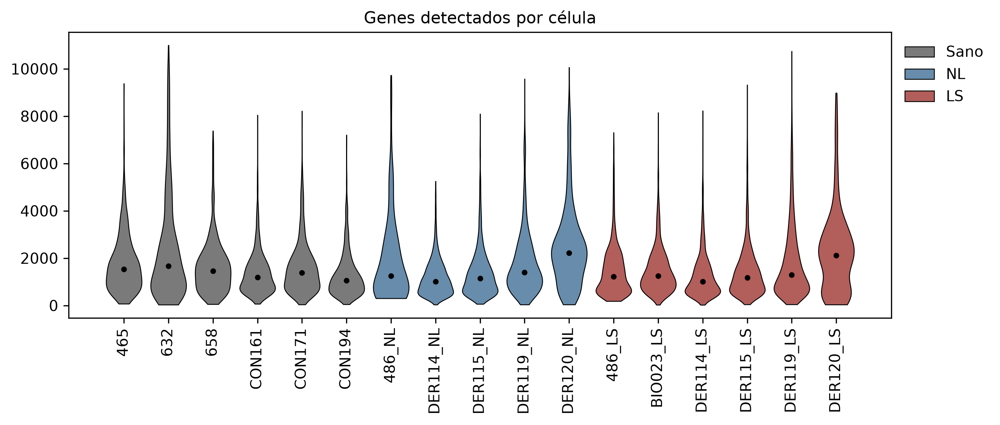

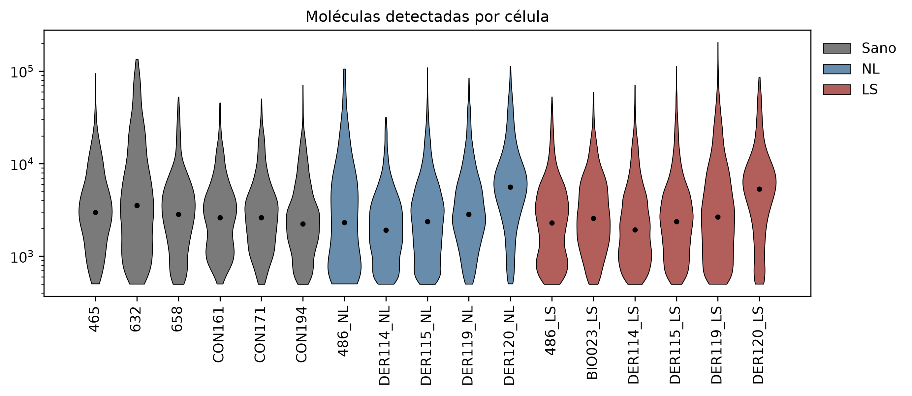

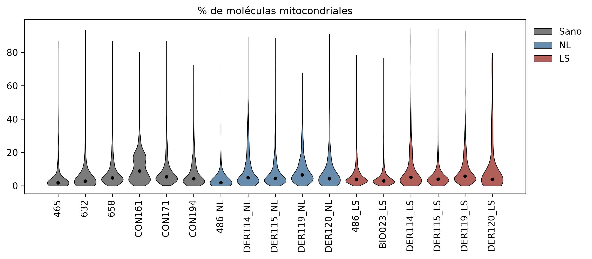

En un violin plot cada figura corresponde a una muestra. La altura indica el valor de la métrica y el ancho indica cuántas células tienen ese valor. Una muestra con la figura desplazada hacia abajo o con una cola larga se comporta distinto a las demás.

### 2. Integración y anotación de tipos celulares (`03_tipos_celulares`)

Los conteos se normalizaron a 10,000 moléculas por célula: cada conteo se dividió entre el total de moléculas de su célula y se multiplicó por 10,000. Después se aplicó log(x + 1). Si una célula se secuenció con el doble de profundidad, todos sus genes aparecen con el doble de conteos sin que cambie su biología. Sin normalizar, las células se agruparían por profundidad de secuenciación y no por tipo celular. El logaritmo reduce el peso de los pocos genes con conteos muy altos.

Se eligieron los 2,000 genes más variables, que son los que distinguen a unos tipos celulares de otros. Scanpy agrupa los genes por su nivel promedio de expresión, calcula la dispersión de cada gen (varianza entre media) y la compara con la de los genes de su mismo nivel. Así, un gen muy expresado no se elige solo por tener números grandes. El cálculo se hizo en cada muestra, y se prefirieron los genes variables en muchas muestras. Muchos de ellos cambian juntos, por ejemplo todas las queratinas aumentan en queratinocitos. El análisis de componentes principales (PCA) aprovecha esto y reemplaza los 2,000 genes por 50 ejes, cada uno una combinación de genes que varían juntos, ordenados de mayor a menor variación explicada.

Las muestras presentaron diferencias técnicas. Por ejemplo, las dos muestras del donante DER120 tenían más genes detectados por célula que el resto. Sin corrección, las células de DER120 se agruparían entre ellas por provenir de esa muestra y no por su tipo celular. Para corregirlo se usó Harmony, que agrupa las células en la PCA y, dentro de cada grupo, acerca las células de cada muestra al centro común. Repite este proceso hasta que deja de cambiar. Harmony modifica solo esta representación y no los conteos, que se conservaron sin cambios para la expresión diferencial.

Con los primeros 30 componentes corregidos se construyó una red de vecinos con `sc.pp.neighbors`. Para cada célula se buscaron las 15 células más cercanas en esos 30 componentes, y se conectó con ellas. Dos células conectadas tienen perfiles de expresión parecidos.

Las células se agruparon con el algoritmo de Leiden. Su antecesor, Louvain, busca dividir la red en comunidades donde haya muchas más conexiones dentro de cada comunidad que entre comunidades distintas. Para lograrlo mueve cada célula a la comunidad de sus vecinas que más mejora esa medida (modularidad), y repite el proceso uniendo comunidades. Su defecto es que puede formar comunidades internamente desconectadas, con partes que solo se unen a través de otra comunidad. Leiden agrega un paso de refinamiento que revisa cada comunidad y la divide si no está bien conectada, lo que garantiza grupos coherentes. Además es más rápido, y es el método estándar en Scanpy. El parámetro de resolución (0.5) controla cuántos grupos se forman.

La PCA y la red tienen 30 dimensiones, que no se pueden dibujar. Si se grafican solo los dos primeros componentes de la PCA, se pierde la información de los otros 28 y muchos tipos celulares quedan encimados. UMAP acomoda las células en dos dimensiones tratando de que cada célula conserve a sus vecinas de la red. Sí pierde información: las distancias entre grupos lejanos y el tamaño de los grupos en el dibujo no tienen significado. Por eso se usó solo para visualizar. El agrupamiento se hizo sobre la red de 30 dimensiones, no sobre el dibujo.

La anotación combinó dos enfoques. Primero se revisó en cada grupo la expresión de marcadores conocidos de cada tipo celular. Algunos son generales (PECAM1 en endotelio de cualquier órgano) y otros propios de la piel (KRT14 en queratinocitos, PMEL en melanocitos). Después, para los grupos sin un marcador clásico claro, se buscaron sin hipótesis previa los genes más expresados en ese grupo contra el resto, con la prueba de Wilcoxon de `rank_genes_groups`, y se identificó el tipo celular a partir de esos genes. La prueba de Wilcoxon ordena las células por su expresión de un gen y revisa si las del grupo tienden a quedar arriba de las demás. Así se anotaron las células de Schwann (CDH19, PMP22, S100B) y la glándula sudorípara (DCD, SCGB2A2, AQP5). Cinco grupos pequeños con mezclas de marcadores de tipos distintos se descartaron como dobletes residuales. Quedaron 20,284 células en 13 tipos celulares, todos esperados en una biopsia de piel que llega a la dermis.

Como control, el número de linfocitos T por muestra se comparó con el que reportaron Brunner et al. en su tabla suplementaria S6, obtenido con su propio control de calidad y anotación. Los conteos coinciden de cerca en las 17 muestras. Por ejemplo, DER115_LS tuvo 458 linfocitos T en este análisis y 433 en el suyo, 465 tuvo 32 y 31, y 486_NL tuvo 0 en ambos. Este análisis conservó en general algunas células más, lo que es consistente con haber usado umbrales de control de calidad permisivos. La única diferencia notable fue CON194 (41 contra 21).

| Tipo celular | Marcadores | Células |
|---|---|---|
| Endotelial | PECAM1, VWF | 4,975 |
| Fibroblasto | COL1A1, DCN | 3,314 |
| Queratinocito basal | KRT14, KRT5 | 2,505 |
| Queratinocito en diferenciación | KRT1, KRT10 | 2,504 |
| Linfocito T | CD3D, CD3E, CD2, TRAC | 1,581 |
| Pericito | RGS5, ACTA2 | 1,544 |
| Glándula sudorípara | KRT19, AQP5, DCD, SCGB2A2 | 1,429 |
| Endotelial linfático | LYVE1, PROX1 | 662 |
| Mieloide | CD14, CD68, LYZ | 559 |
| Célula mioepitelial | KRT14, ACTA2, MYH11 | 330 |
| Músculo liso | ACTA2, MYH11, DES | 299 |
| Melanocito | PMEL, MLANA | 296 |
| Célula de Schwann | CDH19, PMP22, S100B | 286 |

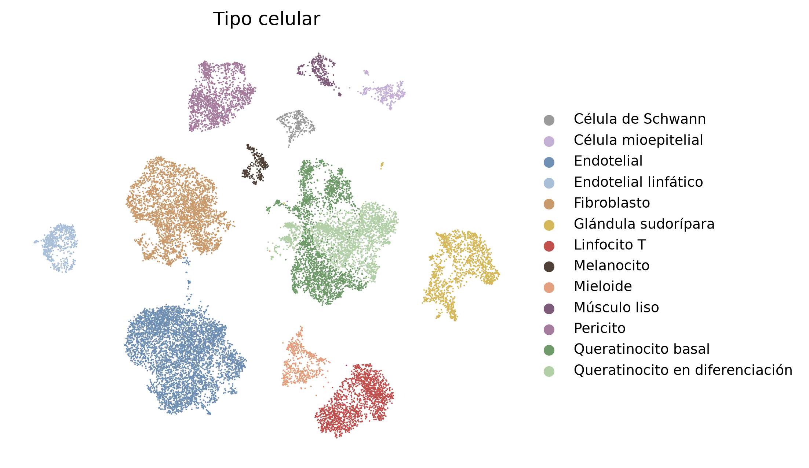

Los melanocitos estuvieron prácticamente ausentes en las seis muestras lesionales (0 a 0.1% de las células) y presentes en piel no lesional y sana. Esto es lo esperado en vitiligo y es consistente con que la anotación de melanocitos y las etiquetas de condición son correctas. No valida la anotación de los demás tipos celulares.

### 3. Subtipos de linfocitos T (`04_linfocitos_T`)

Los linfocitos T se identificaron por la expresión conjunta de CD3D, CD3E, CD2 y TRAC. CD3D y CD3E forman parte del complejo CD3, que transmite la señal del receptor de linfocitos T (TCR). TRAC codifica la región constante de la cadena alfa del TCR. CD2 es una molécula de adhesión de linfocitos T y NK. Se encontraron 1,581 linfocitos T, que se analizaron por separado repitiendo la selección de genes variables, la integración y el agrupamiento.

De los genes variables se excluyeron los 72 segmentos V y J del TCR presentes en los datos (TRAV, TRBV, TRGV y otros). Cada linfocito T tiene un receptor formado por una combinación particular de estos segmentos, y sus descendientes, que forman una clona, comparten esa combinación. Si se conservaran, una clona expandida formaría su propio grupo aunque sus células fueran del mismo subtipo que otras. También se excluyeron los genes mitocondriales y ribosomales, que reflejan el estado o la calidad de la célula y no su identidad.

Se eliminaron 29 células NK, que expresaban GNLY (granulisina, una proteína citotóxica), KLRF1 (un receptor activador propio de NK) y FCGR3A (CD16) con poco CD3, porque las NK no tienen TCR. También se eliminaron 107 células que formaron dos grupos definidos por menos genes detectados y más ARN mitocondrial, sin marcadores biológicos propios, lo que indica baja calidad y no un subtipo. Los 1,445 linfocitos T restantes se clasificaron en seis subtipos.

| Subtipo | Marcadores | Significado de los marcadores | Células |
|---|---|---|---|
| CD4 memoria | CD40LG, TCF7 | CD40LG es propio de CD4 cooperadores. TCF7 indica memoria temprana | 527 |
| CD4 con estrés | CD40LG, CD69, FOS, JUNB | Genes de respuesta inmediata que se activan por estrés durante el procesamiento de la muestra | 515 |
| CD8 GZMK+ | CD8A, GZMK, NKG7 | La granzima K (GZMK) es una enzima de los gránulos citotóxicos. Estos CD8 son de memoria efectora: pueden producir citocinas inflamatorias y matar otras células | 156 |
| CD8 IFNG+ | CD8A, CD69, IFNG | Producen interferón gamma | 132 |
| Treg | FOXP3, CTLA4, IL2RA | FOXP3 es el regulador principal de los Treg | 63 |
| CD8 / gamma delta | CD8A, TRDC | TRDC es la cadena delta de los T gamma delta | 52 |

Ningún marcador es exclusivo de un subtipo. Lo que define a cada grupo es la combinación de marcadores y su nivel relativo.

Las etiquetas se pusieron con marcadores conocidos. Para revisarlas sin hipótesis previa, se buscaron los genes que más distinguen a cada subtipo del resto con `rank_genes_groups` (`04_linfocitos_T`). Esta función usa la prueba de Wilcoxon de suma de rangos, que es la misma prueba que Mann-Whitney con otro nombre. Para cada gen junta las células de un subtipo y las del resto, las ordena de menor a mayor expresión y revisa si las del subtipo tienden a quedar arriba en ese orden. No supone una distribución normal, lo que conviene porque la mayoría de los genes vale cero en muchas células. Aquí cada célula sí cuenta como un dato, lo cual es válido para describir grupos de células pero no para comparar condiciones. Se excluyeron los genes mitocondriales, ribosomales y los segmentos V y J, y se tomaron los genes con mayor expresión en el subtipo.

| Subtipo | Genes que más lo distinguen | ¿Confirma la etiqueta? |
|---|---|---|
| CD8 GZMK+ | GZMK, GZMA, GZMH, NKG7, CCL5, CD8A, CD8B, HLA-DRA | Sí. Granzimas, CD8 y moléculas HLA de clase II, que indican activación |
| CD8 IFNG+ | IFNG, CCL4, CCL5, NKG7, CD69, junto con FOS y DUSP1 | Sí, con algo de señal de estrés |
| Treg | FOXP3, IKZF2, CTLA4, TIGIT, ICOS | Sí. IKZF2 (Helios) y TIGIT son propios de Treg |
| CD8 / gamma delta | ZNF683, FXYD2, KLRK1, HOPX, CTSW, CCL5 | En parte. Son genes de linfocitos citotóxicos residentes o de tipo innato |
| CD4 memoria | IL7R, TXNIP, MALAT1, IKZF1 | En parte. Son genes de linfocitos en reposo, sin un marcador específico |
| CD4 con estrés | FOS, JUNB, DUSP1, HSPA1B, DNAJB1, FOSB | Sí, con el nombre corregido |

Este grupo se nombró al principio "CD4 residente" por su expresión de CD69, que retiene a los linfocitos en el tejido. La revisión mostró que sus genes más distintivos son los genes de respuesta inmediata y de choque térmico que se activan cuando la biopsia se digiere con enzimas (van den Brink et al., 2017). CD69 también es un gen de respuesta inmediata que aumenta con ese estrés. Por eso el grupo se renombró "CD4 con estrés". Probablemente corresponde a linfocitos CD4 que se estresaron durante el procesamiento, y no a un subtipo biológico.

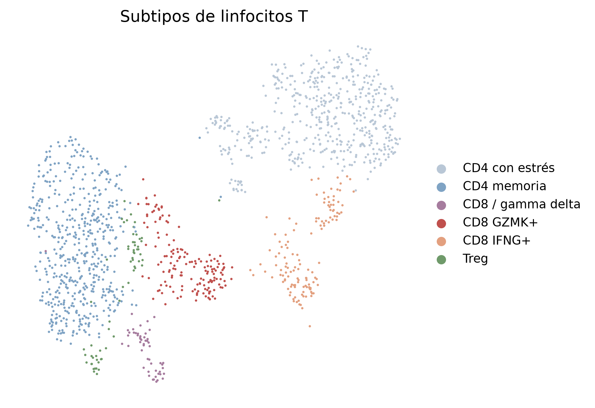

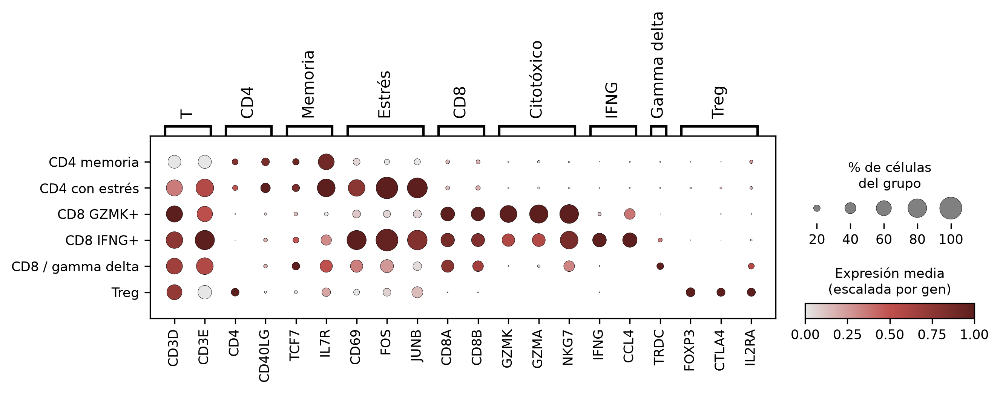

En un dotplot cada fila es un grupo de células y cada columna un gen. El tamaño del punto indica el porcentaje de células del grupo que expresan el gen, y el color indica el nivel promedio de expresión. El color está escalado por gen, de 0 (el grupo con menos expresión de ese gen) a 1 (el grupo con más). Por eso el color compara grupos para un mismo gen, y no sirve para comparar un gen contra otro. Se escaló así porque los genes tienen niveles de expresión muy distintos, y sin escalar los genes muy expresados ocultarían a los demás.

Los linfocitos T estaban muy mal repartidos entre muestras. Dos muestras lesionales, DER114_LS y DER115_LS, contenían el 83% de los T lesionales, y tres muestras tenían menos de 10. Si se comparara célula por célula, el resultado de piel lesional describiría a esas dos personas y no a la enfermedad. Además, tratar cada célula como una observación independiente produce valores p artificialmente pequeños, porque las células de una misma persona se parecen entre sí. Por eso todas las comparaciones entre condiciones usaron la muestra como unidad de análisis: primero se resumieron los linfocitos T de cada biopsia en un solo valor (un porcentaje, un puntaje promedio o una suma de conteos), y las pruebas estadísticas compararon esos valores. Así cada biopsia cuenta como un dato, sin importar cuántas células tenga. Se excluyeron las muestras con menos de 20 linfocitos T, y quedaron 5 sanas, 4 NL y 5 LS.

### 4. Comparaciones entre condiciones

Se usaron cuatro enfoques, todos con la muestra como unidad de análisis. Las pruebas estadísticas responden preguntas distintas.

| Prueba | Pregunta que responde |
|---|---|
| Mann-Whitney | ¿Los valores de un grupo tienden a ser más altos que los de otro? |
| Wilcoxon de suma de rangos | Es la misma prueba que Mann-Whitney. Scanpy la usa célula por célula para encontrar los genes que distinguen a un grupo de células del resto, no para comparar condiciones |
| Spearman | ¿El valor sube o baja de forma consistente en el orden Sano, NL, LS? El coeficiente rho va de −1 (siempre baja) a 1 (siempre sube) |
| Wald de DESeq2 | ¿El cambio de expresión de un gen entre dos grupos es distinto de cero, considerando su variabilidad? |
| Benjamini-Hochberg | De todos los resultados significativos, ¿cuántos esperaríamos que sean falsos? |

**Composición.** Para cada muestra se calculó el porcentaje de cada subtipo dentro de sus linfocitos T, y se compararon los porcentajes entre condiciones con la prueba de Mann-Whitney. Esta prueba compara rangos en lugar de valores y no supone una distribución normal. Pruebas más comunes como la t de Student requieren datos con distribución normal, algo que no se puede comprobar con 4 o 5 valores por grupo, y los porcentajes además están acotados entre 0 y 100. La tendencia Sano, NL, LS se evaluó con la correlación de Spearman, asignando a las condiciones los valores 0, 1 y 2.

**Expresión diferencial por pseudobulk (`05_pseudobulk`, `06_deseq2`).** Para cada muestra se sumaron los conteos crudos de todos sus linfocitos T, y se obtuvo un perfil de expresión por persona. Los perfiles se analizaron con DESeq2, que corrige diferencias en el total de conteos entre muestras, estima la variabilidad de cada gen y prueba si su expresión cambia entre condiciones. Se evaluaron los 3,521 genes con al menos 10 conteos en al menos 4 muestras. Los cambios de expresión se ajustaron con apeglm, un método que reduce hacia cero los cambios estimados de genes con pocos conteos, porque esos cambios son muy inestables. Como análisis de sensibilidad se repitió el modelo incluyendo el sexo, que estaba desbalanceado entre grupos.

**Firmas génicas (`07_firmas`).** Una firma es un conjunto de genes que la célula activa juntos para cumplir una función, como migrar a un tejido o destruir otra célula. Para cada célula se calculó un puntaje por firma con `score_genes` de Scanpy, que compara la expresión promedio de los genes de la firma contra genes de control con un nivel de expresión similar. El puntaje de cada muestra es la media de los puntajes de todos sus linfocitos T.

| Firma | Genes | Motivo |
|---|---|---|
| Residencia en tejido (TRM) | CD69, ITGAE, CXCR6, ITGA1, PDCD1, CD101, CRTAM, RGS1, ZNF683 | Evaluar si NL tiene más linfocitos residentes |
| Th1 | IFNG, TBX21, CXCR3, IL12RB2, STAT4 | Eje inflamatorio principal descrito en vitiligo |
| Th2 | GATA3, IL4, IL5, IL13, CCR4, PTGDR2 | Brunner et al. reportaron marcadores T2 en NL |
| Th17 | RORC, IL17A, IL17F, IL22, CCR6, IL23R | Brunner et al. reportaron marcadores T17 en NL |
| Citotoxicidad | GZMA, GZMB, GZMK, PRF1, NKG7, GNLY | Los CD8 destruyen melanocitos mediante estas moléculas |
| Respuesta a IFN | STAT1, IRF1, GBP1, GBP2, GBP4, GBP5, IFI6, ISG15, MX1 | Genes que se activan cuando la célula recibe interferón |

**Quimiocinas (`08_quimiocinas`).** Las quimiocinas son proteínas que atraen células hacia un sitio. CXCL9, CXCL10 y CXCL11 se producen en respuesta al interferón gamma y atraen a los linfocitos T que tienen el receptor CXCR3. Con Scanpy se calculó, en cada muestra, el porcentaje de células de cada tipo con al menos una molécula de alguna de las tres quimiocinas, y se compararon las condiciones con Mann-Whitney. También se probó LIANA, una herramienta que estima la comunicación entre tipos celulares, pero se descartó porque su filtro de expresión mínima eliminaba las tres quimiocinas.

**Corrección por comparaciones múltiples.** Un valor p menor a 0.05 significa que, si en realidad no hubiera diferencia entre grupos, un resultado así de extremo saldría por azar menos del 5% de las veces. Ese 5% de error se acepta cuando se hace una sola prueba. El problema aparece al hacer muchas. En este proyecto se compararon 6 subtipos, 6 firmas y 3,521 genes. Si ningún gen cambiara de verdad, alrededor de 176 genes (el 5% de 3,521) saldrían con p < 0.05 solo por azar, y no habría forma de distinguirlos de los cambios reales.

El método de Benjamini-Hochberg corrige esto. Ordena los valores p de menor a mayor y multiplica cada uno por el número de pruebas dividido entre su posición en la lista. Por ejemplo, con 3,521 genes, el gen con el p más pequeño se multiplica por 3,521, el segundo por 1,760.5, y así sucesivamente. El valor corregido se llama q. Un resultado con q < 0.05 significa que, de todos los resultados con un q así de bajo, se espera que menos del 5% sean falsos positivos. Esta proporción se llama tasa de descubrimientos falsos (FDR). DESeq2 reporta este mismo valor con el nombre padj. En este README se usa q en todos los casos, y el umbral de significancia es siempre q < 0.05.

## Resultados

### La piel lesional muestra respuesta a interferón en los linfocitos T

La firma de respuesta a interferón fue la única prueba de todo el análisis con q < 0.05. La prueba significativa fue la tendencia Sano, NL, LS (Spearman rho = 0.69, q = 0.037). La comparación directa de LS contra Sano dio p = 0.032, pero no superó la corrección (q = 0.19).

El efecto no es un gradiente. La mediana de NL (−0.003) quedó cerca de la de Sano (−0.012), con p = 0.41 en Mann-Whitney, y la de LS fue mayor (0.050). Los puntajes más altos fueron los de 486_LS (0.20) y BIO023_LS (0.10). Las otras tres muestras lesionales quedaron en el límite superior de las sanas.

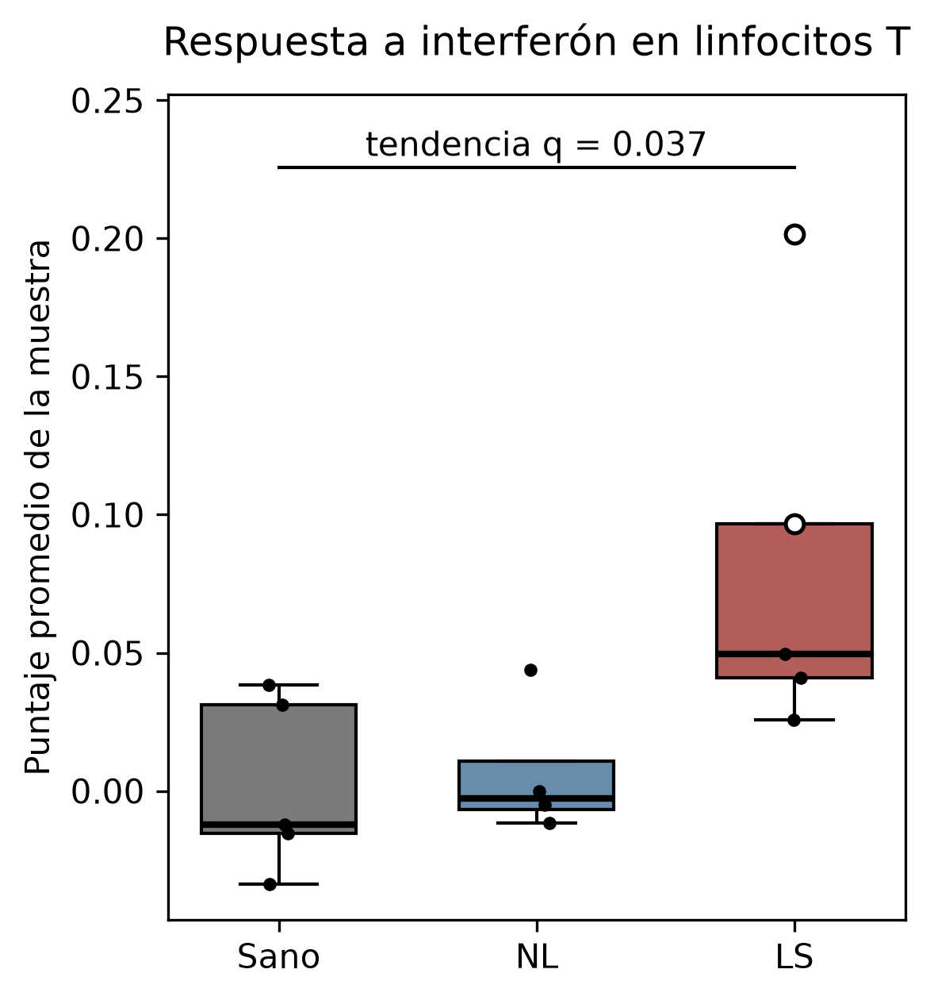

Cada punto es una muestra. Los dos puntos blancos con borde negro son 486_LS y BIO023_LS, las muestras con mayor respuesta a interferón. La barra indica la prueba de tendencia de Spearman entre Sano, NL y LS, con su valor q.

Las otras cinco firmas no mostraron diferencias entre condiciones después de la corrección.

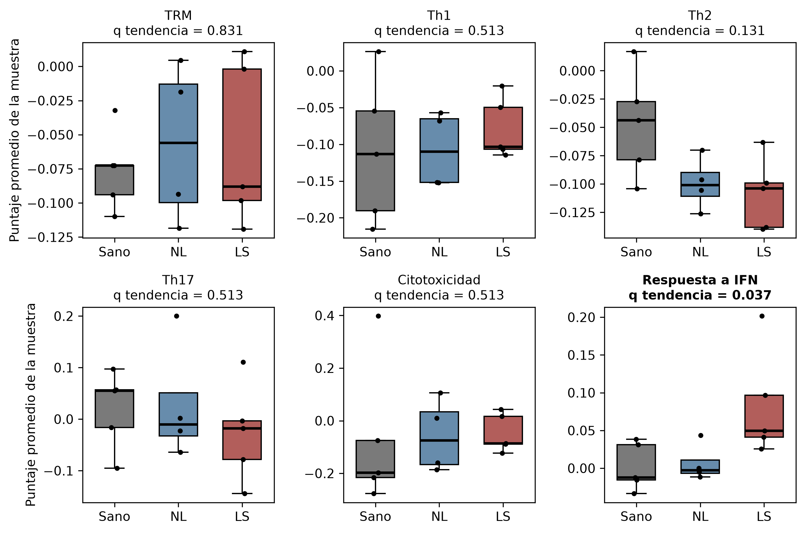

Para saber si el resultado depende de muestras particulares, se repitió la prueba quitando grupos de muestras (`07_firmas`). Son valores p sin corregir, porque aquí se evalúa una sola firma.

| Escenario | Muestras (Sano, NL, LS) | p LS contra Sano | rho tendencia | p tendencia |
|---|---|---|---|---|
| Todas las muestras | 5, 4, 5 | 0.032 | 0.69 | 0.006 |
| Sin CON194 | 4, 4, 5 | 0.063 | 0.65 | 0.016 |
| Sin DER114_LS y DER115_LS | 5, 4, 3 | 0.036 | 0.74 | 0.006 |
| Sin 486_LS y BIO023_LS | 5, 4, 3 | 0.143 | 0.57 | 0.055 |

El resultado no depende de las dos muestras con más linfocitos T ni de la muestra sana atípica. Sí depende de 486_LS y BIO023_LS. Sin ellas, la tendencia se mantiene en la misma dirección pero deja de ser significativa.

El heatmap muestra la expresión pseudobulk de los genes de las firmas de interferón y de residencia en cada muestra. Permite ver si el puntaje de una firma se debe a varios genes que suben juntos o a uno solo. Cada gen se convirtió a z-score, que indica cuántas desviaciones estándar se aleja una muestra del promedio de ese gen en las 14 muestras. Rojo es por encima del promedio y azul por debajo. Igual que en el dotplot, la comparación es entre muestras para un mismo gen, y el color no compara un gen contra otro. Solo aparecen los genes que pasaron el filtro de conteos del pseudobulk.

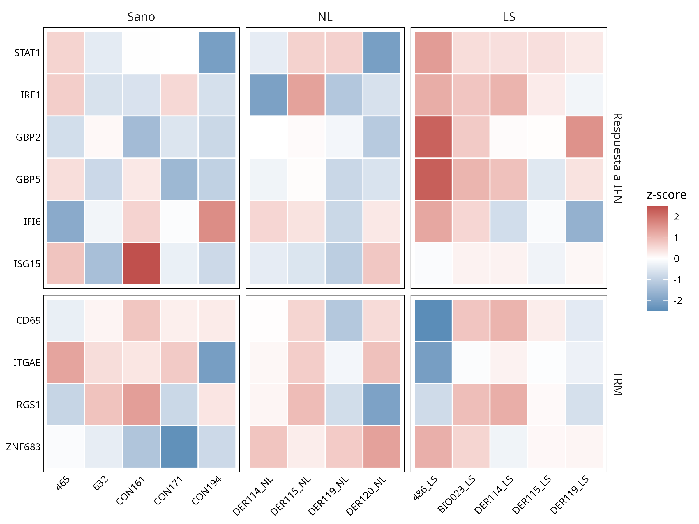

En 486_LS suben juntos STAT1, IRF1, GBP2 y GBP5, y en las demás muestras lesionales IRF1 y GBP5 tienden a estar por encima de las sanas. Estos genes responden sobre todo al interferón gamma. En cambio, ISG15 e IFI6, que responden más al interferón de tipo I, no muestran un patrón por condición, y sus valores más altos están en dos muestras sanas (CON161 y CON194). Esto es consistente con una respuesta a interferón gamma, el interferón descrito en vitiligo, y no con una respuesta antiviral general.

Este resultado coincide con el mecanismo descrito en vitiligo. Los linfocitos T CD8 producen interferón gamma (IFN-γ), que se une a su receptor en las células de la piel y activa a las enzimas JAK1 y JAK2. Estas activan al factor de transcripción STAT1, que induce las quimiocinas CXCL9 y CXCL10. Las quimiocinas atraen más linfocitos T con el receptor CXCR3, que a su vez producen más IFN-γ y destruyen más melanocitos, de modo que la inflamación se mantiene sola. Rashighi et al. (2014) mostraron en ratón que sin CXCL10 o sin CXCR3 la despigmentación casi no ocurre. Los inhibidores de JAK, como el ruxolitinib tópico, bloquean esta vía y son el tratamiento aprobado para vitiligo. Que los linfocitos T de la piel lesional expresen genes de respuesta a interferón indica que están recibiendo esta señal. Junto con la ausencia de melanocitos, funciona como control positivo de que el análisis detecta biología conocida.

### En piel no lesional no se detectó un cambio robusto

En la composición de subtipos, la piel no lesional mostró tendencias hacia menos CD4 con estrés y Treg, y más CD8 GZMK+, respecto a piel sana (p = 0.063 a 0.11). Ninguna superó la corrección. El umbral de significancia es q < 0.05, y el q más bajo de estas comparaciones fue 0.19. Además, los porcentajes de cada muestra suman 100, de modo que el aumento de un subtipo obliga a la disminución de otros, y estas tendencias pueden ser un solo cambio visto desde varios subtipos. La tendencia hacia menos CD4 con estrés probablemente es técnica, y reflejaría que las muestras NL se estresaron menos durante el procesamiento. Estos datos no permiten afirmar un cambio de composición.

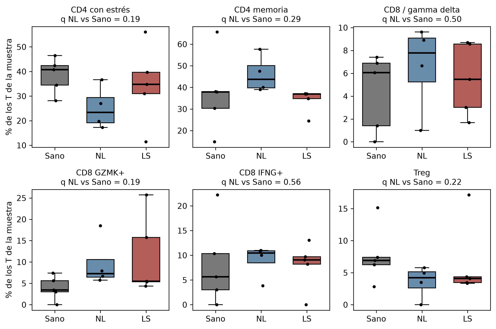

En la expresión diferencial, los genes no se eligieron de antemano. DESeq2 probó los 3,521 genes uno por uno, y se ordenaron por su valor p. FXYD2 y ZNF683 fueron los dos primeros de la lista en NL contra Sano, y solo FXYD2 fue significativo (q = 0.029). FXYD2 codifica una subunidad de la bomba de sodio y potasio, y su función en linfocitos T no está bien descrita. El segundo gen fue ZNF683 (q = 0.20), que codifica el factor de transcripción Hobit. En ratón, Hobit y Blimp1 dirigen el programa de residencia en tejido de los linfocitos (Mackay et al., 2016). En humanos, Hobit también se expresa en linfocitos T CD8 efectores y células NK de sangre (Vieira Braga et al., 2015), por lo que no es un marcador exclusivo de residencia. Las cuatro muestras NL tuvieron más ZNF683 que las cinco sanas, sin traslape.

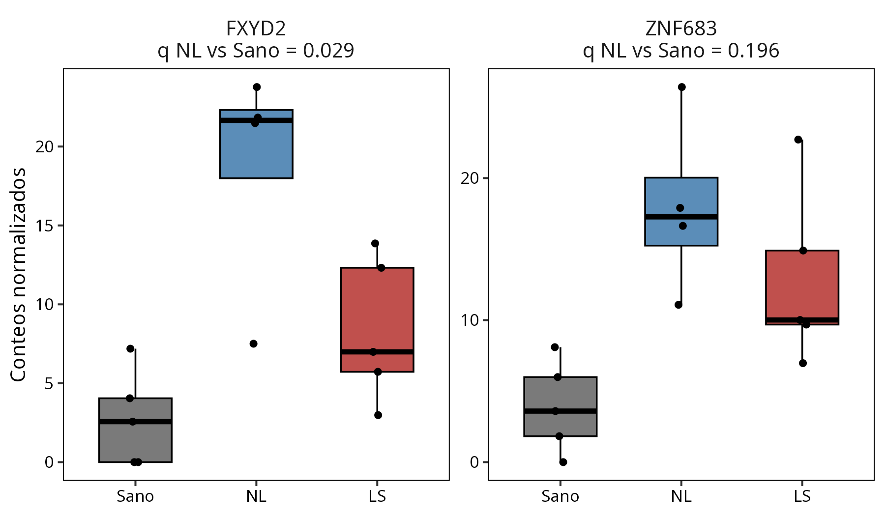

La expresión diferencial también se repitió en varios escenarios (`09_sensibilidad`).

| Escenario | Genes con q < 0.1 en NL contra Sano | q FXYD2 | q ZNF683 |
|---|---|---|---|
| Todas las muestras | 1 | 0.029 | 0.20 |
| Sin CON194 | 1 | 0.024 | 0.34 |
| Sin DER114_LS y DER115_LS | 1 | 0.022 | 0.11 |
| Con sexo en el modelo | 0 | 0.11 | 0.96 |

FXYD2 se mantiene al quitar muestras y solo pierde significancia al incluir el sexo. El sexo se dedujo de los genes del cromosoma Y, y los grupos quedaron desbalanceados (Sano 3 hombres y 2 mujeres, NL 1 y 3, LS 1 y 4). Sin embargo, FXYD2 tuvo entre 0 y 3 conteos en las cinco muestras sanas, tanto de hombres como de mujeres, por lo que la pérdida de significancia parece deberse más a que el modelo con sexo tiene menos poder (solo hay 2 mujeres sanas) que a un efecto real del sexo. ZNF683 no fue significativo en ningún escenario.

FXYD2 y ZNF683 no deben tomarse como hallazgos. Son candidatos que valdría la pena revisar en otra cohorte, por estas razones:

| Motivo | Por qué resta confianza |
|---|---|
| Pocos conteos | Ambos genes tienen alrededor de 10 moléculas por muestra. Con números tan bajos, unas pocas moléculas de más o de menos cambian mucho el resultado |
| Sensibles al modelo | Al incluir el sexo, FXYD2 pierde significancia. ZNF683 nunca fue significativo |
| Origen de las muestras | Las cuatro muestras NL provienen de donantes con identificador DER, y ninguna muestra sana lo tiene. Si ese prefijo corresponde a otro centro o periodo de recolección, la diferencia podría deberse a eso y no a la enfermedad. GEO no describe qué significan los identificadores |
| ARN y no proteína | El análisis mide transcritos. Que suba el ARN de ZNF683 no demuestra que haya más proteína Hobit ni que cambie su actividad |
| Sin respaldo de genes relacionados | Si ZNF683 reflejara más linfocitos residentes, los demás genes de residencia también deberían subir |

El último punto se puede revisar con los datos. Hobit actúa junto con otras proteínas del programa de residencia, como CD69, ITGAE y CXCR6, para retener a la célula en el tejido. Si en NL hubiera más linfocitos residentes, todos estos genes subirían juntos. ZNF683 aparece en el heatmap porque forma parte de la firma TRM, y FXYD2 no aparece porque no pertenece a ninguna firma. En el heatmap, ZNF683 sube en las cuatro muestras NL sin que CD69, ITGAE ni RGS1 lo acompañen, y la firma TRM completa no cambió (p = 0.73). La revisión de marcadores de los subtipos aclara de dónde vienen los dos genes. ZNF683 y FXYD2 son los dos genes que más distinguen al subtipo CD8 / gamma delta, junto con KLRK1 y HOPX. Es decir, no son dos hallazgos independientes, sino dos marcadores del mismo grupo pequeño de 52 células. En el pseudobulk, que suma todos los linfocitos T de la muestra, ambos genes suben si la muestra tiene más células de ese grupo o si sus demás linfocitos expresan más ese programa. El porcentaje de CD8 / gamma delta no fue claramente mayor en NL (mediana 7.8% contra 6.1% en Sano, p = 0.41), y DER115_NL tuvo FXYD2 alto con solo 1% de esas células. Por eso los datos no permiten decidir entre las dos explicaciones, y la variación aleatoria por pocos conteos sigue siendo posible.

Si FXYD2 y ZNF683 volvieran a salir juntos en NL contra Sano en otra cohorte, sí valdría la pena estudiarlos. Indicarían que un grupo de linfocitos citotóxicos de tipo residente o innato cambia en la piel antes de que aparezca la lesión.

La firma Th2 de los linfocitos T fue más baja en NL y LS que en Sano (p de tendencia = 0.044, q = 0.13), en dirección opuesta al aumento de marcadores T2 que Brunner et al. reportaron en el tejido. Las dos observaciones no son directamente comparables, porque varios de esos marcadores del tejido, como CCL17 y CCL22, los producen células distintas a los linfocitos T.

### Piel lesional contra no lesional del mismo paciente

Las comparaciones anteriores tratan a las muestras NL y LS del mismo paciente como independientes. Para comparar dentro de cada persona, se ajustó DESeq2 con el donante en el modelo, usando los tres pacientes con ambas muestras y al menos 20 linfocitos T (DER114, DER115 y DER119). Así, cada muestra LS se compara contra la NL de la misma persona.

Ningún gen tuvo q < 0.1. Los genes con menor p fueron ATF3, HSPA1B, RGCC, TNFAIP3, NR4A1, DNAJB1, HSP90AA1 y GADD45B, más altos en LS. Son genes de respuesta inmediata y de choque térmico que se activan cuando las células se estresan durante la disociación enzimática de la biopsia (van den Brink et al., 2017). Su presencia sugiere que las muestras lesionales tuvieron más estrés durante el procesamiento, no un cambio biológico. Los genes de respuesta a interferón tuvieron cambios pequeños, la mayoría en dirección positiva (GBP5, GBP2, ISG15 e IRF1 con log2FC entre 0.3 y 0.5), pero ninguno cercano a la significancia. Con tres pares, esta comparación no tiene poder para detectar cambios moderados.

### Hipótesis sobre la piel no lesional

Si las tendencias se confirmaran en una cohorte más grande, describirían una piel no lesional con más linfocitos CD8 efectores y menos Treg, un balance que favorecería el daño a melanocitos antes de que aparezca la lesión. Esta idea es compatible con lo que describieron Gellatly et al. (2021). En piel no lesional encontraron activación inmune subclínica, es decir, inflamación que todavía no causa una lesión visible. También encontraron que los Treg de esa piel frenan a los linfocitos CD8 efectores. En un modelo de ratón, los Treg sin el receptor CCR5 no lograban ubicarse bien en la piel ni frenar la enfermedad, y la despigmentación empeoraba. Si los Treg mantienen controlada la piel no lesional, tener menos Treg podría ser un paso previo a la lesión. Con los datos de este proyecto es solo una hipótesis.

### Las quimiocinas CXCL9/10/11 no se detectaron lo suficiente

Las tres quimiocinas se detectaron en menos del 2% de las células en la mayoría de las muestras, y casi nunca en queratinocitos. Hay dos explicaciones posibles. La biológica sería que estas quimiocinas realmente no se producen en estas muestras. La técnica sería que sí se producen, pero el método no logra medirlas. La evidencia apoya la técnica. En vitiligo, los queratinocitos se han descrito como una fuente principal de CXCL9 y CXCL10 (Shiu et al., 2022), y en su cohorte de 15 pacientes Brunner et al. detectaron CXCL9 aumentado en piel lesional y no lesional con RNA-seq bulk, un método más sensible para genes poco expresados. Si las quimiocinas existen en el tejido y no aparecen aquí, el problema está en la medición. Por eso este resultado no permite concluir que el eje esté apagado.

Los fibroblastos de piel lesional tuvieron un mayor porcentaje de células que expresaban al menos una de las tres quimiocinas que los de piel sana (p = 0.028, sin significancia tras la corrección). Es un resultado plausible, porque los fibroblastos también responden al interferón gamma, pero no es concluyente.

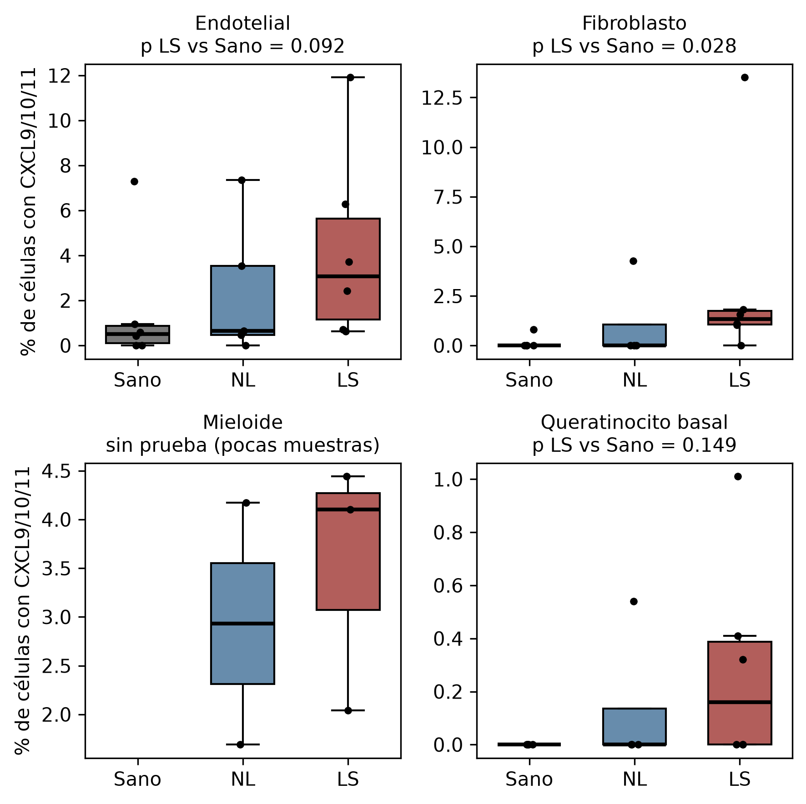

Cada punto es una muestra, y solo se incluyeron las muestras con al menos 30 células del tipo. En células mieloides no hubo suficientes muestras sanas para hacer la prueba.

La baja detección puede tener dos causas técnicas. Para obtener células individuales, la biopsia se digiere con enzimas que separan las células del tejido. Ese proceso estresa a las células, cambia su expresión y pierde algunos tipos celulares. Además, la plataforma 10x captura solo una fracción de las moléculas de ARN de cada célula, de modo que un gen expresado en bajo nivel puede aparecer en cero aunque la célula lo esté expresando. Con estos datos no se puede evaluar el eje CXCL9/10 y CXCR3.

## Conclusión

En este dataset, los linfocitos T de piel lesional muestran una respuesta a interferón gamma consistente con la biología conocida del vitiligo. Es el único resultado que superó la corrección por comparaciones múltiples. Se mantiene al quitar la muestra sana atípica y las dos muestras con más linfocitos T, pero depende de 486_LS y BIO023_LS, que podrían ser lesiones activas.

En piel no lesional no se encontró una alteración robusta. Esto no demuestra que los linfocitos T de NL sean normales. Con cuatro muestras NL solo se detectarían cambios muy grandes, y Brunner et al. sí encontraron alteraciones en el tejido completo con 15 pacientes. Las tendencias observadas (más CD8 GZMK+, menos Treg, más ZNF683) no superan la corrección y quedan como hipótesis para validar en una cohorte independiente. El dataset no se diseñó para estudiar los linfocitos T, y el siguiente paso es repetir el análisis en el dataset de Gellatly et al. (2021).

## Limitaciones

| Limitación | Efecto | Posible solución |
|---|---|---|
| Pocas muestras por grupo (5, 4 y 5) | Solo se detectan diferencias grandes. Con 4 contra 5 muestras, el p mínimo posible en Mann-Whitney es 0.016 | Validar en otra cohorte o combinar datasets |
| Linfocitos T concentrados en dos muestras | Obliga a analizar por muestra y deja a varias muestras con pocas células | Se repitieron los análisis sin DER114_LS y DER115_LS, y los resultados no cambiaron |
| Muestras NL y LS del mismo donante | No son independientes. La correlación de Spearman las trata como si lo fueran | Se hizo la comparación pareada con el donante en el modelo, pero con tres pares no tiene poder. Requiere más pacientes con ambas muestras |
| Sexo desbalanceado entre grupos | FXYD2 pierde significancia al ajustarlo, probablemente por pérdida de poder | Cohorte con sexo balanceado |
| Todas las muestras NL vienen de donantes DER y ninguna sana | La comparación NL contra Sano puede reflejar el origen de las muestras y no la enfermedad | El material suplementario no lo aclara. Consultar a los autores o validar en otra cohorte |
| Una muestra sana (CON194) se separa en la PCA del pseudobulk | Sus diferencias vienen de genes técnicos y del cromosoma Y, no de la condición | Se repitieron los análisis sin CON194, y los resultados no cambiaron |
| Estrés por disociación | Los genes de estrés dominan la comparación LS contra NL | Excluir o modelar una firma de estrés por disociación |
| Sin datos clínicos por paciente | 486_LS y BIO023_LS mostraron la mayor respuesta a interferón y podrían ser lesiones activas, pero GEO no incluye ese dato | Brunner et al. midieron dos escalas clínicas: VASI (Vitiligo Area Scoring Index), que mide qué porcentaje de la piel perdió pigmento, y VIDA (Vitiligo Disease Activity), que mide si en los últimos meses aparecieron lesiones nuevas o crecieron las existentes. Su material suplementario solo reporta promedios de la cohorte de RNA-seq bulk, no valores por paciente. Para saber si 486 y BIO023 tenían enfermedad activa habría que pedir los datos a los autores |
| Quimiocinas casi no detectadas | No se pudo evaluar el eje CXCL9/10 y CXCR3 | Medir con métodos más sensibles, como RNA-seq bulk, PCR en tiempo real o transcriptómica espacial |

## Reproducir el análisis

Se necesitan conda o mamba. Hay dos entornos, uno para Python y otro para R.

```bash
mamba env create -f envs/environment.yml
mamba env create -f envs/environment-r.yml
```

Para usar R en JupyterLab hay que registrar su kernel una vez, con los dos entornos activos:

```bash
mamba activate vitiligo-t
mamba activate --stack vitiligo-t-r
R -e 'IRkernel::installspec(name = "vitiligo-t-r", displayname = "R (vitiligo-t-r)")'
```

Después se descargan los datos desde la raíz del repositorio y se corren los notebooks en orden:

```bash
bash scripts/01_descargar.sh
```

| Notebook | Kernel | Contenido |
|---|---|---|
| `01_carga` | Python | Carga de las 17 muestras |
| `02_qc` | Python | Control de calidad y dobletes |
| `03_tipos_celulares` | Python | Integración, agrupamiento y anotación |
| `04_linfocitos_T` | Python | Subtipos de T y composición |
| `05_pseudobulk` | Python | Suma de conteos por muestra |
| `06_deseq2` | R | Expresión diferencial y heatmap |
| `07_firmas` | Python | Puntajes de firmas |
| `08_quimiocinas` | Python | Expresión de CXCL9/10/11 |
| `09_sensibilidad` | R | Expresión diferencial sin muestras atípicas y LS contra NL pareado |

Las figuras se guardan en `results/figuras` y las tablas en `results/tablas`.

## Referencias

**Biología**

Brunner PM, David E, Del Duca E, et al. Transcriptomic profiling of vitiligo patients shows polar immune dysregulation in involved and uninvolved skin. *J Allergy Clin Immunol*. 2025;156(4):993-1007. [doi:10.1016/j.jaci.2025.06.002](https://doi.org/10.1016/j.jaci.2025.06.002). Datos: [GSE298871](https://www.ncbi.nlm.nih.gov/geo/query/acc.cgi?acc=GSE298871).

Gellatly KJ, Strassner JP, Essien K, et al. scRNA-seq of human vitiligo reveals complex networks of subclinical immune activation and a role for CCR5 in Treg function. *Sci Transl Med*. 2021;13(610):eabd8995. [doi:10.1126/scitranslmed.abd8995](https://doi.org/10.1126/scitranslmed.abd8995)

Rashighi M, Agarwal P, Richmond JM, et al. CXCL10 is critical for the progression and maintenance of depigmentation in a mouse model of vitiligo. *Sci Transl Med*. 2014;6(223):223ra23. [doi:10.1126/scitranslmed.3007811](https://doi.org/10.1126/scitranslmed.3007811)

Shiu J, Zhang L, Lentsch G, et al. Multimodal analyses of vitiligo skin identify tissue characteristics of stable disease. *JCI Insight*. 2022;7(13):e154585. [doi:10.1172/jci.insight.154585](https://doi.org/10.1172/jci.insight.154585)

Mackay LK, Minnich M, Kragten NAM, et al. Hobit and Blimp1 instruct a universal transcriptional program of tissue residency in lymphocytes. *Science*. 2016;352(6284):459-463. [doi:10.1126/science.aad2035](https://doi.org/10.1126/science.aad2035)

Vieira Braga FA, Hertoghs KML, Kragten NAM, et al. Blimp-1 homolog Hobit identifies effector-type lymphocytes in humans. *Eur J Immunol*. 2015;45(10):2945-2958. [doi:10.1002/eji.201545650](https://doi.org/10.1002/eji.201545650)

van den Brink SC, Sage F, Vértesy Á, et al. Single-cell sequencing reveals dissociation-induced gene expression in tissue subpopulations. *Nat Methods*. 2017;14(10):935-936. [doi:10.1038/nmeth.4437](https://doi.org/10.1038/nmeth.4437)

**Software y métodos**

Wolf FA, Angerer P, Theis FJ. SCANPY: large-scale single-cell gene expression data analysis. *Genome Biol*. 2018;19:15. [doi:10.1186/s13059-017-1382-0](https://doi.org/10.1186/s13059-017-1382-0)

Wolock SL, Lopez R, Klein AM. Scrublet: computational identification of cell doublets in single-cell transcriptomic data. *Cell Syst*. 2019;8(4):281-291. [doi:10.1016/j.cels.2018.11.005](https://doi.org/10.1016/j.cels.2018.11.005)

Korsunsky I, Millard N, Fan J, et al. Fast, sensitive and accurate integration of single-cell data with Harmony. *Nat Methods*. 2019;16:1289-1296. [doi:10.1038/s41592-019-0619-0](https://doi.org/10.1038/s41592-019-0619-0)

Traag VA, Waltman L, van Eck NJ. From Louvain to Leiden: guaranteeing well-connected communities. *Sci Rep*. 2019;9:5233. [doi:10.1038/s41598-019-41695-z](https://doi.org/10.1038/s41598-019-41695-z)

McInnes L, Healy J, Melville J. UMAP: Uniform Manifold Approximation and Projection for dimension reduction. arXiv. 2018. [arXiv:1802.03426](https://arxiv.org/abs/1802.03426)

Love MI, Huber W, Anders S. Moderated estimation of fold change and dispersion for RNA-seq data with DESeq2. *Genome Biol*. 2014;15:550. [doi:10.1186/s13059-014-0550-8](https://doi.org/10.1186/s13059-014-0550-8)

Zhu A, Ibrahim JG, Love MI. Heavy-tailed prior distributions for sequence count data: removing the noise and preserving large differences. *Bioinformatics*. 2019;35(12):2084-2092. [doi:10.1093/bioinformatics/bty895](https://doi.org/10.1093/bioinformatics/bty895)

Benjamini Y, Hochberg Y. Controlling the false discovery rate: a practical and powerful approach to multiple testing. *J R Stat Soc Series B*. 1995;57(1):289-300. [doi:10.1111/j.2517-6161.1995.tb02031.x](https://doi.org/10.1111/j.2517-6161.1995.tb02031.x)
